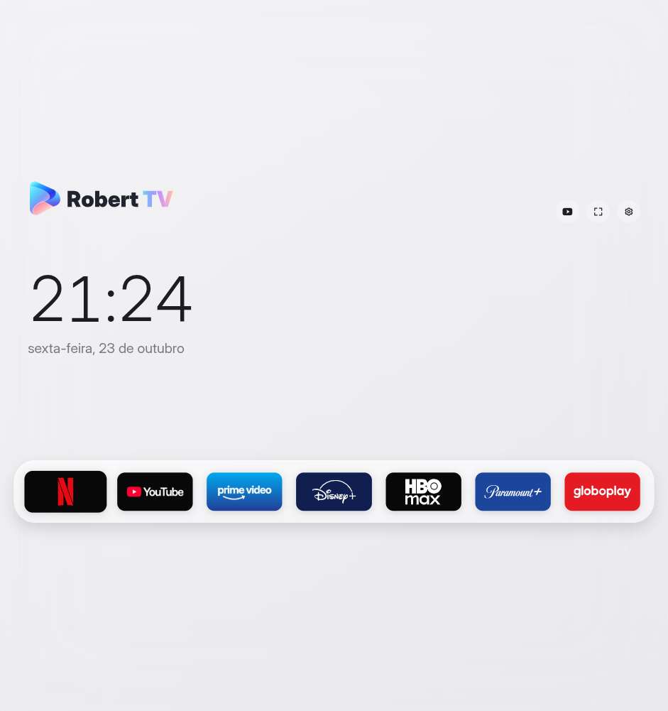

# RobertTV Desktop

Uma central de streaming para o seu computador, com relógio, data e os seus serviços em uma única janela. Interface em português, temas claro e escuro e navegação por teclado.



## Baixar

Os downloads ficam em **[Releases](https://github.com/robertlindomar/RobertTv-Desktop/releases)**.

| Sistema | Pacote | Estado |
| --- | --- | --- |
| Linux x64 | `RobertTV-Desktop-0.1.0-linux-x64.tar.gz` | Sete serviços testados pelo autor em Omarchy/Arch Linux |
| Windows x64 | `RobertTV-Desktop-0.1.0-windows-x64.zip` | Experimental; sem validação de reprodução no Windows e sem assinatura VMP de produção |

### Linux

1. Extraia o `.tar.gz` para uma pasta permanente, por exemplo `~/Aplicativos`.
2. Execute `./RobertTV` dentro da pasta extraída.
3. Para adicionar ao menu, execute `./instalar-icone.sh`. Depois procure **RobertTV Desktop** no lançador (no Omarchy, Super+Espaço).

Não precisa instalar Node.js ou npm para usar o pacote. Não execute como root. O sistema precisa das bibliotecas de desktop exigidas pelo Electron e de sandbox compatível. O pacote é Linux x64; outras distribuições ainda precisam ser validadas.

### Windows — versão experimental

1. Extraia **todo** o ZIP para uma pasta permanente.
2. Abra `RobertTV.exe`.
3. Opcional: execute `Criar-atalho.ps1` para criar um atalho no Menu Iniciar.

O programa não tem assinatura Authenticode. A reprodução de serviços com DRM no Windows pode exigir assinatura Widevine/VMP de produção; esse pacote ainda não a possui. Não há garantia de reprodução da Netflix, Prime Video ou outros provedores no Windows nesta versão. Consulte [a documentação da Castlabs](https://github.com/castlabs/electron-releases/wiki/EVS). Não alteramos configurações de segurança do Windows nem contornamos DRM.

Na primeira execução, o motor baixa o componente Widevine pelo seu mecanismo de atualização. É necessário acesso à internet; no Linux, o componente pode exigir reabrir o aplicativo na primeira instalação.

## Serviços

Netflix, YouTube, Prime Video, Disney+, HBO Max, Paramount+ e Globoplay abrem diretamente dentro do RobertTV. Cada serviço mantém o próprio login e requer a sua conta/assinatura quando aplicável. O aplicativo não oferece catálogo ou assinaturas e não é afiliado aos provedores.

- **Esc** ou **Alt+Home**: voltar ao início. No player em tela cheia, o primeiro Esc pode apenas sair da tela cheia.
- **Alt+Esquerda**: voltar à página anterior.
- **F11**: alternar tela cheia.
- Mova o mouse para o canto superior esquerdo para revelar os botões de navegação.
- Na tela inicial, use setas, Tab e Enter ou mouse.
- Nas configurações, o interruptor de tema salva a preferência automaticamente.

## Dados e privacidade

Os pacotes não contêm contas, senhas, cookies ou perfis do autor. Cada pessoa entra nos próprios serviços. Na versão distribuída, os dados ficam em `RobertTV-Desktop` dentro da pasta de dados do usuário (`%APPDATA%` no Windows e a pasta de configuração do usuário no Linux). Substituir os arquivos do programa não apaga essa pasta; deslogamentos ainda podem ocorrer pelas regras de cada serviço.

O checkout pessoal de desenvolvimento mantém o perfil anterior em `.runtime/ecs`. Ele não é copiado para o repositório ou para os downloads. O aplicativo não compartilha perfis com o navegador padrão.

## Desenvolvimento

Requisitos: Node.js 22 ou mais recente e Python 3.

```bash
npm ci
npm run runtime:install
npm run desktop
```

O script obtém **Castlabs Electron for Content Security 44.9.3+wvcus** e verifica o SHA-256 publicado na mesma release antes de extraí-lo. O Electron padrão não substitui esse motor para a reprodução protegida.

```bash
# Empacotar no Linux:
npm run package:linux
# Baixar o motor Windows e criar o ZIP a partir do Linux:
npm run runtime:install -- --windows
npm run package:windows
# Verificação de desenvolvimento, com perfil separado:
npm run desktop -- --verify-services
```

Os builds usam uma lista explícita de arquivos públicos. `.runtime`, `.browser`, `node_modules`, diagnósticos e segredos ficam fora dos pacotes. O workflow de build verifica os pacotes em runners Linux e Windows; isso valida inicialização e interface, não contas pagas ou reprodução dos provedores.

## Licença e créditos

Código sob MIT, com a atribuição ao Free My TV preservada. Veja [LICENSE](LICENSE) e [ASSET-CREDITS.md](ASSET-CREDITS.md). Marcas de streaming pertencem aos respectivos titulares. O controle pelo celular está fora do escopo desta versão.
