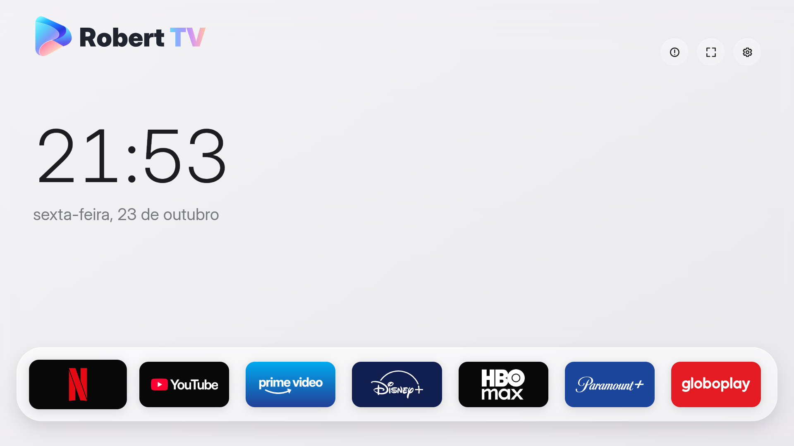
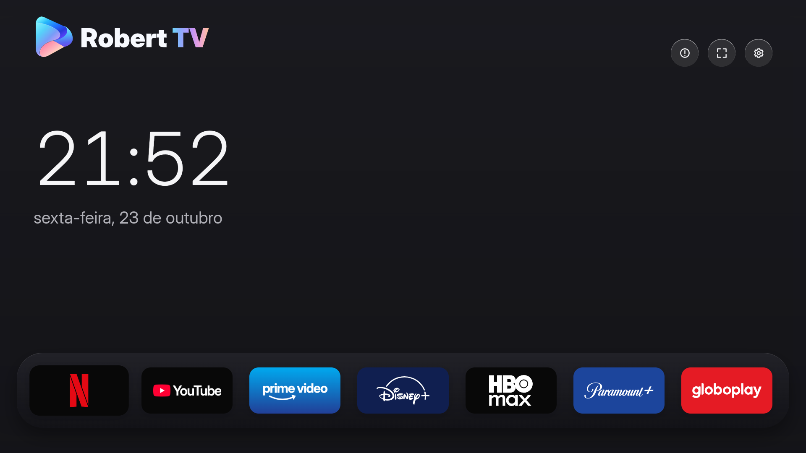

# RobertTV Desktop

Uma central de streaming para o seu computador, com relógio, data e os seus serviços em uma única janela. Interface em português, temas claro e escuro e navegação por teclado. Feito por [Robert Lindomar](https://robertlindomar.com.br).

**Tema claro**



**Tema escuro**



## Baixar

Os downloads ficam em **[Releases](https://github.com/robertlindomar/RobertTv-Desktop/releases)**.

| Sistema | Pacote | Estado |
| --- | --- | --- |
| Linux x64 | `RobertTV-Desktop-0.1.1-linux-x64.tar.gz` | Sete serviços testados pelo autor em Omarchy/Arch Linux |
| Windows x64 | `RobertTV-Desktop-0.1.1-windows-x64.zip` | Experimental; sem validação de reprodução no Windows e sem assinatura VMP de produção |

### Linux

1. Extraia o `.tar.gz` para uma pasta permanente, por exemplo `~/Aplicativos`.
2. Execute `./RobertTV` dentro da pasta extraída.
3. Para adicionar ao menu, execute `./instalar-icone.sh`. Depois procure **RobertTV Desktop** no lançador (no Omarchy, Super+Espaço).

Não precisa instalar Node.js ou npm para usar o pacote. Não execute como root. O sistema precisa das bibliotecas de desktop exigidas pelo Electron e de sandbox compatível. O pacote é Linux x64; outras distribuições ainda precisam ser validadas.

### Windows — versão experimental

1. Extraia **todo** o ZIP para uma pasta permanente.
2. Abra `RobertTV.exe`.
3. Opcional: execute `Criar-atalho.ps1` para criar um atalho no Menu Iniciar.

O programa não tem assinatura Authenticode. A reprodução de serviços com DRM no Windows pode exigir assinatura Widevine/VMP de produção; esse pacote ainda não a possui. Não há garantia de reprodução da Netflix, Prime Video ou outros provedores no Windows nesta versão. Consulte [a documentação da Castlabs](https://github.com/castlabs/electron-releases/wiki/EVS). Não alteramos configurações de segurança do Windows nem contornamos DRM.

Na primeira execução, o motor baixa o componente Widevine pelo seu mecanismo de atualização. É necessário acesso à internet; no Linux, o componente pode exigir reabrir o aplicativo na primeira instalação.

## Serviços

Netflix, YouTube, Prime Video, Disney+, HBO Max, Paramount+ e Globoplay abrem diretamente dentro do RobertTV. Cada serviço mantém o próprio login e requer a sua conta/assinatura quando aplicável. O aplicativo não oferece catálogo ou assinaturas e não é afiliado aos provedores.

- **Esc** ou **Alt+Home**: voltar ao início. No player em tela cheia, o primeiro Esc pode apenas sair da tela cheia.
- **Alt+Esquerda**: voltar à página anterior.
- **F11**: alternar tela cheia.
- Mova o mouse para o canto superior esquerdo para revelar os botões de navegação.
- Na tela inicial, use setas, Tab e Enter ou mouse.
- Nas configurações, o interruptor de tema salva a preferência automaticamente.

## Dados e privacidade

Os pacotes não contêm contas, senhas, cookies ou perfis do autor. Cada pessoa entra nos próprios serviços. Na versão distribuída, os dados ficam em `RobertTV-Desktop` dentro da pasta de dados do usuário (`%APPDATA%` no Windows e a pasta de configuração do usuário no Linux). Substituir os arquivos do programa não apaga essa pasta; deslogamentos ainda podem ocorrer pelas regras de cada serviço.

O checkout pessoal de desenvolvimento mantém o perfil anterior em `.runtime/ecs`. Ele não é copiado para o repositório ou para os downloads. O aplicativo não compartilha perfis com o navegador padrão.

## Desenvolvimento

Requisitos: Node.js 22 ou mais recente e Python 3.

```bash
npm ci
npm run runtime:install
npm run desktop
```

O script obtém **Castlabs Electron for Content Security 44.9.3+wvcus** e verifica o SHA-256 publicado na mesma release antes de extraí-lo. O Electron padrão não substitui esse motor para a reprodução protegida.

```bash
# Empacotar no Linux:
npm run package:linux
# Baixar o motor Windows e criar o ZIP a partir do Linux:
npm run runtime:install -- --windows
npm run package:windows
# Verificação de desenvolvimento, com perfil separado:
npm run desktop -- --verify-services
```

Os builds usam uma lista explícita de arquivos públicos. `.runtime`, `.browser`, `node_modules`, diagnósticos e segredos ficam fora dos pacotes. O workflow de build verifica os pacotes em runners Linux e Windows; isso valida inicialização e interface, não contas pagas ou reprodução dos provedores.

## Licença e créditos

Código sob MIT, com a atribuição ao Free My TV preservada. Veja [LICENSE](LICENSE) e [ASSET-CREDITS.md](ASSET-CREDITS.md). Marcas de streaming pertencem aos respectivos titulares. O controle pelo celular é opcional e funciona diretamente pela rede local.


## Controle pelo celular (Wi-Fi local)

Em teste na branch `main` (0.2.0-beta.1). Os downloads da versão 0.1.1 ainda não incluem este recurso.

Nas configurações, abra **Controle pelo celular** e clique em **Ativar controle por Wi-Fi**. Escaneie o QR Code com o celular na mesma rede, informe o código temporário e confirme a autorização no computador. Não é necessário Tailscale, conta adicional, servidor externo ou abrir portas no roteador.

O servidor escuta somente no IPv4 privado da interface local selecionada automaticamente (porta 8788, ou uma das nove seguintes se ela estiver ocupada). Redes de convidados podem isolar os dispositivos. No Windows, se houver solicitação do firewall, permita apenas a rede privada; o aplicativo não altera o firewall.

O controle oferece atalhos dos serviços, início/voltar, setas/OK, touchpad com cursor visível e toque para clicar, rolagem com um dedo na faixa lateral direita ou com dois dedos no touchpad, teclado, play/pause, avanço de dez segundos, volume da mídia e silenciar o áudio do aplicativo. Volume e reprodução dependem de o player do serviço aceitar os comandos; o touchpad é a alternativa para operar seus próprios botões. Não controla outros programas, volume global do sistema, arquivos ou terminal.

O código expira em cinco minutos, tem limite de tentativas e exige confirmação no desktop. Somente um controle é pareado por vez, por até oito horas ou até fechar o aplicativo. Há botões para desconectar o celular, regenerar o código e desativar o servidor. O pareamento usa cookie HttpOnly e SameSite; não inclui senhas de streaming. A conexão HTTP não é criptografada: use apenas uma rede local de confiança, sem encaminhar a porta para a internet.

```bash
npm test
npm run desktop -- --verify-remote
# Abrir diretamente o pareamento no computador:
npm run desktop -- --remote
```

As verificações usam perfis separados. O teste nativo confirma o pareamento pela página móvel, navegação, touchpad e digitação, além de controles de mídia com um áudio de teste local. A reprodução de cada provedor ainda deve ser conferida pelo usuário.


### Ícone do controle na tela inicial do celular

Na página do controle, toque em **Adicionar** no cartão “Seu controle, a um toque”. O assistente mostra os passos conforme o aparelho. No Safari do iPhone, use Compartilhar → Adicionar à Tela de Início e, se disponível, Abrir como App da Web. No Android, use o menu do navegador → Adicionar à tela inicial; o nome da opção pode variar.

O controle fornece nome, ícones e manifesto com modo standalone. A instalação automática de PWA depende das regras do navegador e normalmente exige HTTPS; no endereço HTTP da rede local oferecemos o atalho manual. Não registramos service worker nem prometemos uso offline: o computador precisa estar ligado e com o controle ativo. Ao abrir pelo ícone pela primeira vez, o navegador pode usar uma sessão separada e pedir um novo pareamento. Se o endereço IP do computador mudar, será necessário atualizar o atalho.
